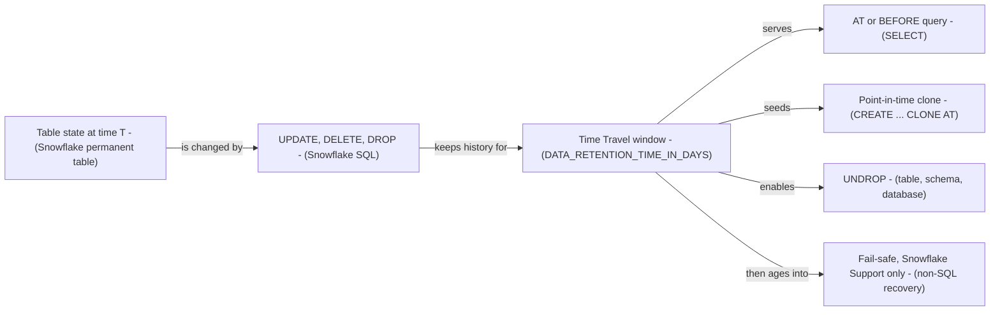

# Snowflake Time Travel and Fail-safe - Architecture and design rationale

*Last updated: 2026-11-07 · commit 2edefc322*

## 1. Purpose and scope

A learning tutorial on Snowflake's data-protection features: querying history with `AT` and `BEFORE`, point-in-time
clones, `UNDROP`, retention settings, and the cost relationship between Time Travel, Fail-safe and transient tables. It
is for the author's own development and for readers. It is not a backup or recovery design. The repository does not say
whether it was run against a trial, sandbox or other account; that is not documented.

## 2. How this project was built

This project was built with Claude Code (Anthropic's AI coding assistant) in a complementary role. Elliott Fairhall is
the author and owner: the project is debugged, tested and used by him for learning and development, and the design
decisions below are explained so that they can be understood, questioned and learned from. The repository holds no
record of the scripts or notebook being run, so this document does not claim one.

## 3. Architecture at a glance

Time Travel is a window behind the present; the three recovery techniques all depend on being inside it. Fail-safe
starts where the window ends and is not user-accessible.

## 4. Learning path

Scripts (reference snippets, with fixed placeholders):

| Step | File                                | What it teaches                                                                     | Why here                                                   |
| ---- | ----------------------------------- | ----------------------------------------------------------------------------------- | ---------------------------------------------------------- |
| 0    | `00_setup_environment.sql`          | `TT_ANALYTICS.MARTS.DIM_CUSTOMERS` with two rows; `TT_ANALYTICS_TRANSIENT` database | A table with history to look back on                       |
| 1    | `01_querying_historical_data.sql`   | `AT (TIMESTAMP)`, `AT (OFFSET)`, `BEFORE (STATEMENT)`, a current-vs-past join       | Reading history is the safest operation, so it comes first |
| 2    | `02_cloning_point_in_time.sql`      | Clone a table, schema and database `AT` a point                                     | Turns reading into a durable restore                       |
| 3    | `03_restoring_dropped_objects.sql`  | `UNDROP` for table, schema, database; rename-then-undrop (all commented out)        | Destructive, so after the read-only steps                  |
| 4    | `04_configuring_data_retention.sql` | `DATA_RETENTION_TIME_IN_DAYS` at table, schema, database; transient table           | The cost lever, once the reader knows what it buys         |

The notebook `notebook/Time_Travel_Failsafe_Tutorial.ipynb` runs the same story in its own disposable database: setup,
five employees, "accidental" `UPDATE` and `DELETE`, `AT(OFFSET => -120)` and `BEFORE(STATEMENT => ...)` queries, a
restoring clone, `DROP` then `UNDROP`, a retention change, cleanup. The tutorial's order (introduction, query, clone,
restore, Fail-safe, retention) is documented; the "Why here" column is inferred.

## 5. Design rationale

### Read, then clone, then undrop, then configure

- **Why:** each step is more powerful and more destructive than the last, and the retention step needs the reader to
  know what retention buys.
- **Gave up:** a reader wanting a quick "undo my mistake" recipe has to read through.
- **Alternative not taken:** start with the accidental-drop story as the hook.
- **Evidence:** inferred from the order.

### Scripts use fixed timestamps and a fake query ID

- **Why (inferred):** to show the syntax with recognisable values.
- **Gave up:** `AT (TIMESTAMP => '2026-03-24 14:00:00')` and `BEFORE (STATEMENT => '01b2c3d4-...')` cannot run as
  written; a literal timestamp that falls before the table existed errors, and the query ID is a placeholder. Offsets
  such as `-1800` or `-3600` also fail if the table is younger than the offset.
- **Alternative not taken:** capture `CURRENT_TIMESTAMP()` and `LAST_QUERY_ID()` in a variable, as the notebook partly
  does.
- **Evidence:** inferred from the code. Script 00 says "wait some time (or modify records), and use Time Travel".

### The notebook uses its own database and `CREATE OR REPLACE`

- **Why:** `time_travel_tutorial_db` is created and dropped by the notebook, so `TT_ANALYTICS` (the scripts' database)
  is untouched. Setting `DATA_RETENTION_TIME_IN_DAYS = 1` explicitly keeps the lesson within what the tutorial says
  every edition allows.
- **Gave up:** `AT(OFFSET => -120)` assumes the "accident" happened under two minutes earlier and the rows existed two
  minutes before that, so it is timing-sensitive; the captured `snapshot_time` is never used. `LAST_QUERY_ID(-2)` is
  also order-dependent.
- **Alternative not taken:** use `snapshot_time` in an `AT (TIMESTAMP => ...)` clause.
- **Evidence:** visible in the notebook code.

### Cost and safety considerations

- Longer retention increases storage held for changed data, and permanent tables also carry Fail-safe; the tutorial says
  so and recommends transient tables for non-critical data. The cost mechanism is the tutorial's claim; the pricing is
  not verified here. `TODO: verify`
- Script 04 sets table retention 30 days, schema 14, database 7. Table values override the schema and database, so the
  tutorial's own order is the reverse of a tidy hierarchy. The tutorial's table says Standard edition's maximum is 1
  day, so these statements may fail on a Standard account. `TODO: verify`
- Script 02 clones a whole schema and a whole database (`analytics`). Clones are described as zero-copy, but a database
  clone includes every table in `TT_ANALYTICS`, and the backups are never dropped.
- The notebook drops its database at the end; dropped permanent objects stay recoverable within retention and Fail-safe,
  so cleanup is not instant storage release. `TODO: verify`
- `00_setup_environment.sql` creates `TT_ANALYTICS_TRANSIENT` with a comment "Create a transient environment" but
  without the `TRANSIENT` keyword, so it is an ordinary permanent database.

### Fail-safe is explained, not demonstrated

- **Why:** the tutorial says Fail-safe is recoverable only by Snowflake Support, so no SQL can show it.
- **Gave up:** no hands-on exercise; the retention figures (1 and 90 days, 7 days Fail-safe) are the tutorial's claims.
  `TODO: verify`
- **Alternative not taken:** query storage metrics views to show Fail-safe bytes.
- **Evidence:** documented in the tutorial.

## 6. Quality and testing

No tests or CI. The notebook stores no outputs. Failure would show as "time travel is not available for the selected
point" style errors or a clone or `UNDROP` that restores unexpected data.

## 7. Constraints, limitations and known gaps

- `00_setup_environment.sql` uses `CREATE OR REPLACE TABLE TT_ANALYTICS.MARTS.DIM_CUSTOMERS`, which the Stored
  Procedures and UDFs tutorial also creates with different columns. In a Time Travel tutorial this replace erases the
  history being studied.
- `02_cloning_point_in_time.sql` creates `analytics.marts_backup`, `analytics_backup` and
  `tt_analytics.staging.customers_backup` with no cleanup.
- `TT_ANALYTICS_TRANSIENT` is created but never used.
- Script 01's `BEFORE (STATEMENT => ...)` and timestamps are placeholders.
- Script 03 is entirely commented out, including a duplicate `UNDROP TABLE` after a rename.
- Notebook step 7 calls `UNDROP` after `DROP` in the same schema where `employees_restored` also exists; fine, but the
  notebook then raises retention to 3 days, which may fail on Standard. `TODO: verify`
- The README lists an empty `data/` folder that is not tracked.

## 8. Running and extending

Setup and usage are in the [README](../README.md) and the [tutorial](../Tutorial/TIME_TRAVEL_FAILSAFE_TUTORIAL.md). To
extend safely: use the notebook's disposable database, capture timestamps and query IDs rather than hardcoding them, and
add a cleanup script for clones.

## 9. Rationale (confirmed by the owner)

Confirmed by Elliott Fairhall on 2026-11-07. This reasoning was first reconstructed from the code and commit history;
the owner has since agreed it is correct, so it is now the stated rationale rather than an inference.

- The read, clone, undrop, configure order is deliberate, from safest to riskiest, then cost.
- Fixed timestamps in the scripts are illustrative, not meant to be run verbatim.
- The notebook was built with its own database so destructive steps (drop, undrop) cannot hit objects in `TT_ANALYTICS`.
- Fail-safe is only described because it cannot be exercised with SQL.
- `TT_ANALYTICS_TRANSIENT` was intended as a transient database to illustrate cost saving but was not completed.
